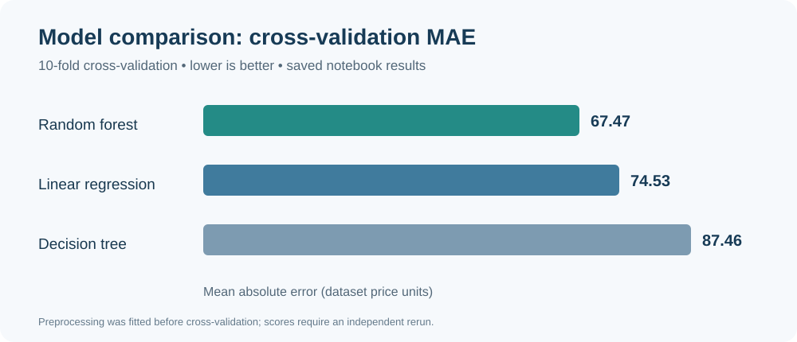

# New York City Airbnb Price Prediction

**Python · pandas · scikit-learn · regression · model evaluation**

How can listing characteristics help explain variation in New York City Airbnb prices? This project explores 2019 listing data and develops regression models to estimate price from location, room type, availability, and other listing features.

**Course:** CSE 4502 — Big Data Analytics, University of Connecticut  
**Project type:** Course programming assignment  
**Notebook:** [Explore the original analysis](notebooks/nyc_airbnb_original.ipynb)

## What the analysis covers

- Explore listing prices and relationships with geographic and listing features.
- Prepare numeric and categorical variables using median imputation, scaling, and one-hot encoding.
- Compare linear regression, decision trees, and random forest regression using mean absolute error (MAE).
- Tune a random forest using cross-validation and assess predictions on a held-out test set.
- Examine feature importance and prediction errors.

## Dataset and features

The original analysis reads a local file named `AB_NYC_2019_1.csv`. It uses NYC Airbnb listing data from 2019; the dataset is not included in this repository. A [similarly named 2019 NYC Airbnb dataset on Kaggle](https://www.kaggle.com/dgomonov/new-york-city-airbnb-open-data) may be suitable, but the exact match with the file used in the notebook has not yet been confirmed.

Features used include neighbourhood group, room type, latitude, longitude, minimum nights, review counts, reviews per month, host listing count, and annual availability. Price is the prediction target.

## Results from the saved notebook

The original run reports the following mean absolute error (MAE). Lower values indicate smaller average absolute differences between predicted and listed prices.

| Model / evaluation | MAE (price units) | Evaluation |
|---|---:|---|
| Linear regression | 74.53 | 10-fold cross-validation |
| Decision tree | 87.46 | 10-fold cross-validation |
| Initial random forest | 67.47 | 10-fold cross-validation |
| Grid-search random forest | 66.41 | 5-fold cross-validation during tuning |
| Selected grid-search random forest | **64.08** | Held-out test set |

*The chart compares the three initial models using the same 10-fold cross-validation setup. The held-out test result is shown separately in the table.*

The notebook's grid search selected a random forest with 30 trees and `max_features=2`. Its separate randomized search reported a best cross-validation MAE of 64.81, but the notebook's final held-out test result uses the **grid-search** model, not the randomized-search model.

In the randomized-search model's feature-importance output, longitude and latitude were the two largest individual contributions (approximately 0.256 and 0.234). These are model-specific importance scores, not causal effects.

**Interpretation:** The initial random forest had a lower cross-validation MAE than the linear and decision-tree models in the saved run. The tuned model's held-out error was about 64 price units per listing on average. The test and cross-validation values represent different evaluation stages and are not directly interchangeable.

These numbers are taken from saved notebook outputs; they have **not been independently reproduced**. The notebook fits preprocessing on all training data before cross-validation, so cross-validation results may be optimistic. See the limitations below.

## Interpretation and current limitations

- The analysis uses a random 80/20 train/test split. Although a notebook heading calls it stratified, the displayed split does not specify stratification.
- The preprocessing pipeline is fitted to the full training set before cross-validation. A future revision should place preprocessing and the estimator in one pipeline so preprocessing is refit within each fold.
- The dataset used in the original run must be checked against the linked candidate before the analysis can be reproduced.
- The notebook contains the original course instructions and exploratory work. Package versions and a clean rerun remain to be verified.

## Running the original notebook

1. Obtain the 2019 NYC Airbnb CSV used in the analysis and place it next to the notebook as `AB_NYC_2019_1.csv`.
2. Open [the notebook](notebooks/nyc_airbnb_original.ipynb) in Jupyter or Google Colab.
3. Install the Python packages used in the notebook, including pandas, NumPy, matplotlib, and scikit-learn, then run the cells in order.

Exact dependency versions and the match to the original dataset are still being established.

## Skills demonstrated

Data exploration · preprocessing · regression · cross-validation · hyperparameter search · feature importance · error analysis

Originally developed as a CSE 4502 course assignment and presented here as part of Hiral Choksi's data science portfolio.
